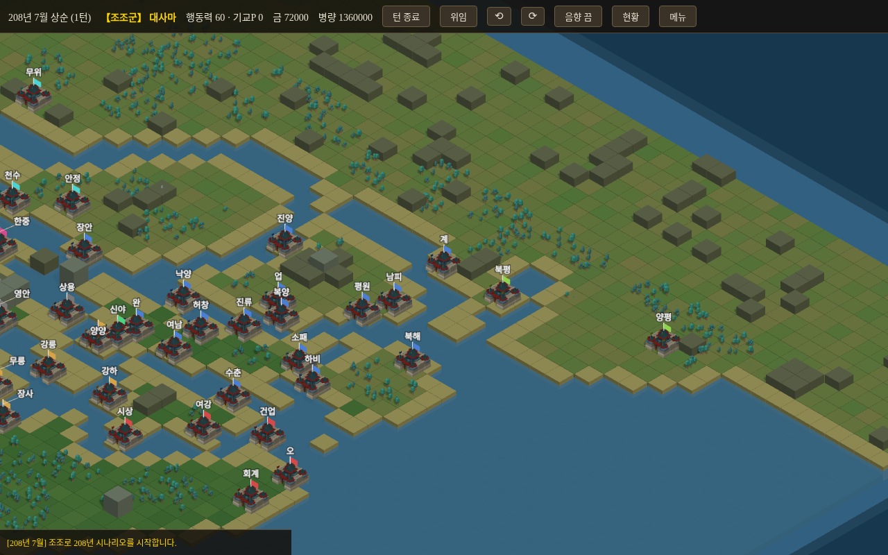
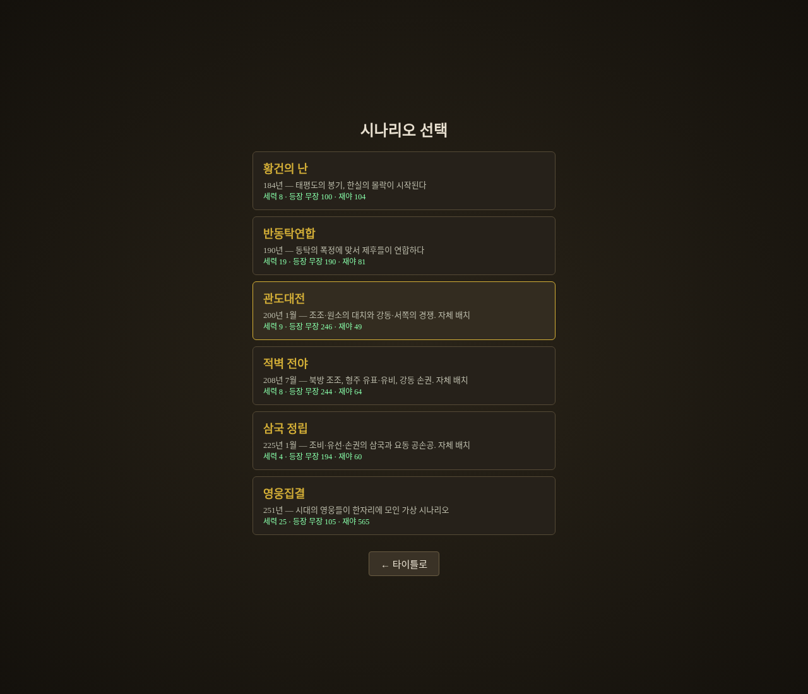
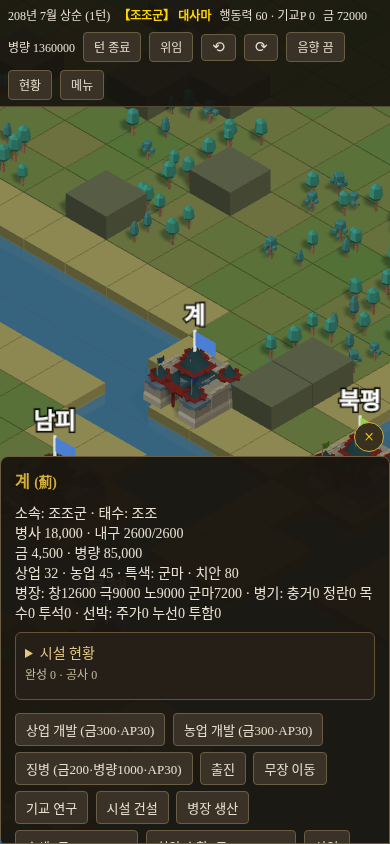
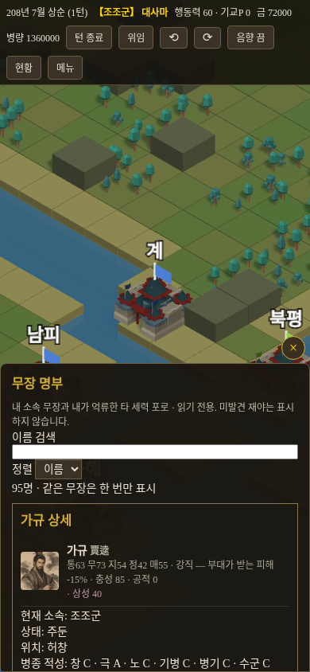

# 삼국지 샌드박스

**직접 지휘하고, AI에 맡기고, 다른 군주로 이어가는 삼국지 웹 시뮬레이션.**

42개 도시가 놓인 3D 지도에서 내정·외교·전투를 진행합니다. 자기 세력을 AI에 위임해 전황을 지켜보다가, 다른 세력에 참가해 같은 세계를 이어갈 수 있습니다.

### [▶ 브라우저에서 플레이하기](https://sigco3111.github.io/samgukji-sandbox/)

설치 없이 실행하는 개발 중 시험판입니다. PC와 모바일 화면에 대응하며, 저장은 현재 기기의 브라우저에 보관됩니다.



*공개판 실제 화면: 208년 적벽 전야 · 조조군 · 1턴. 아래 화면은 2026-11-04에 촬영했습니다.*

> 코에이 『삼국지11』의 시스템을 참고한 **비공식 독립 팬 프로젝트**입니다. 원작의 공식 제품·이식판이 아니며, 원작 게임의 파일·이미지·음악은 포함하지 않습니다. 능력치와 게임 규칙은 프로젝트 자체 데이터·수치입니다.

## 처음 플레이한다면

1. **새 게임**에서 시나리오와 군주를 선택합니다.
2. 내 도시를 눌러 개발·징병·수색·출진 등 명령을 내립니다. 금·병량·행동력 조건을 확인하세요.
3. **턴 종료**를 누르면 세계가 진행됩니다. 1턴은 10일이며, 3턴이 한 달입니다.
4. **위임**을 누르면 내 세력도 AI가 운영합니다. 속도를 조절하거나 **직접 지휘**로 돌아올 수 있습니다.
5. 위임 중 다른 세력의 도시를 눌러 **이 세력으로 참가**를 선택하면 턴 경계에서 지휘권을 넘겨받습니다. 미결 결정이 있으면 먼저 처리합니다.

세력이 멸망해도 다른 세력으로 계속하거나 관전을 이어갈 수 있습니다. 새 게임으로 되돌리지 않고 같은 전황을 이어가는 것이 핵심입니다.

## 여섯 개의 시작점

- **184 · 황건의 난**: 황건 봉기와 후한 말의 혼란
- **190 · 반동탁연합**: 동탁과 제후들의 대치
- **200 · 관도대전**: 조조·원소의 경쟁과 각지 세력
- **208 · 적벽 전야**: 북방 조조, 형주의 경쟁, 강동 손권
- **225 · 삼국 정립**: 위·촉·오와 요동 세력
- **251 · 영웅집결**: 시대를 넘나드는 가상 배치



*시나리오는 역사에서 영감을 받은 자체 배치입니다. 특히 200·208·225년은 특정 전투의 정밀 재현이나 역사대로 흘러가는 각본 모드가 아닙니다.*

## 할 수 있는 것

### 도시와 인재
- 상업·농업 개발, 징병, 치안 순찰, 금↔병량 상인 거래
- 내정시설 건설·흡수합병, 병장·병기 생산과 선박 건조
- 인재 수색·등용·이동, 명품 발견과 포로 처리
- 관직·군사 임명, 기교·능력 연구, 도시를 묶는 군단 운영
- 무장 670명 데이터와 **초상화 660장** 연결. 나머지 인물은 대체 이미지로 표시

### 외교와 전장
- 친선 사절, 동맹·정전, 원군 요청, 항복 권고와 수신 제안의 수락·거절
- 검·창·극·노·기병, 공성 병기와 수군의 이동·야전·공성
- 전법·계략, 일기토·설전, 부대·도시·시설의 화재와 소화
- 빈 지형 화계: 3턴 유지, 접촉한 육군에 소속과 무관하게 화상 적용. 즉시 피해·확산은 없음
- 직접 지휘 시 시야 제한, 주요 사건 연감, 세력 현황·무장 명부·전투 보고

### 모바일 화면

도시 정보와 명령



무장 명부와 개별 능력



*390px 너비의 브라우저 화면입니다. 실물 휴대폰의 터치·음향·성능을 검증했다는 뜻은 아닙니다.*

## 조작과 저장

| 조작 | 방법 |
| --- | --- |
| 지도 이동 | 마우스 또는 손가락으로 드래그 |
| 확대·축소 | 마우스 휠 또는 두 손가락 핀치 |
| 지도 회전 | 상단 ⟲ / ⟳ 버튼 |
| 도시·부대 정보 | 지도에서 클릭 또는 탭 |
| 부대 이동 | 내 부대를 선택한 뒤 목표 도시 선택 |
| 현황·명부·보고 | 상단 **현황** 또는 **메뉴** |
| 소리 | **음향** 버튼으로 켜기·끄기 |
| 이어하기 | 같은 브라우저의 타이틀에서 **이어하기** |

- 진행은 브라우저 로컬 저장소에 자동 저장됩니다. **메뉴 → 저장하고 타이틀로**로 나갈 수도 있습니다.
- 저장은 계정·클라우드에 동기화되지 않습니다. 다른 기기·브라우저·사이트 주소와 공유되지 않으며, 사이트 데이터를 지우면 사라질 수 있습니다.
- 새 게임을 시작하면 기존 저장을 덮어쓰기 전에 확인합니다. 저장 실패 안내가 나오면 새로고침하거나 닫지 말고 저장을 다시 시도하세요.
- 브라우저를 닫아 둔 동안 세계가 자동으로 진행되지는 않습니다.

## 개발 상태와 한계

기능은 계속 다듬고 있습니다. **기능이 있다는 것과 장기 플레이 품질이 충분하다는 것은 다릅니다.**

- AI의 군량 부족·무장 편중, 장기 전략과 밸런스는 개선 과제입니다.
- 전투·외교·위임·세력 전환·저장 연결은 확인 범위를 넓혀 가는 중입니다. 모든 상황의 안정성을 보장하지 않습니다.
- 지도 가독성과 실물 휴대폰의 터치·화면 방향 전환·음향·GPU 성능은 추가 확인이 필요합니다.
- 결전제패·PK 모드 전체 재현이나 원작과 같은 규칙·수치를 목표로 한 완성판은 아닙니다.

## 데이터와 권리

- 코드·지형·초상화는 이 프로젝트에서 독립적으로 작성·생성했습니다. 연결된 초상화 660장은 AI 생성 이미지이며, 원작 아트를 사용하지 않습니다.
- 인물·도시 이름과 역사 연도는 사실 자료를 바탕으로 합니다. 능력 5종·병종 적성·특기·충성도·등장 조건·경제·병력·시나리오 배치는 프로젝트 자체 평가와 규칙을 사용합니다.
- 한자→한글 독음은 `sigco3111/dragon` 저장소의 사전을 참고했습니다. 독음이 확인되지 않은 일부 이름은 한자로 표시될 수 있습니다.
- 상표와 원작의 권리는 각 권리자에게 있습니다. 이 프로젝트는 공식 서비스와 무관합니다.

## 로컬에서 실행하기

저장소를 내려받은 폴더에서 정적 서버를 실행합니다.

```bash
python3 -m http.server 8000
```

브라우저에서 `http://localhost:8000`을 엽니다. 파일을 직접 더블클릭하는 대신 서버로 실행하세요. Three.js를 CDN에서 불러오므로 인터넷 연결이 필요합니다.

### 코드 구성

빌드 과정이 없는 HTML·CSS·JavaScript 정적 사이트이며 GitHub Pages로 배포합니다.

| 경로 | 역할 |
| --- | --- |
| `js/game.js` | 턴 처리와 게임 규칙 |
| `js/ai.js` | 세력 AI |
| `js/map3d.js` | Three.js 지도와 입력 |
| `js/main.js` | 화면과 명령 연결 |
| `data/` | 무장·특기·시나리오 데이터 |
| `portraits-atlas/` | 초상화 아틀라스 |

회귀 검사는 Node.js에서 `node tools/smoke-all.mjs`로 실행할 수 있습니다. 항목별 구현·검증 기록은 [설계 대조 문서](docs/design-coverage.md)에 정리되어 있습니다.
